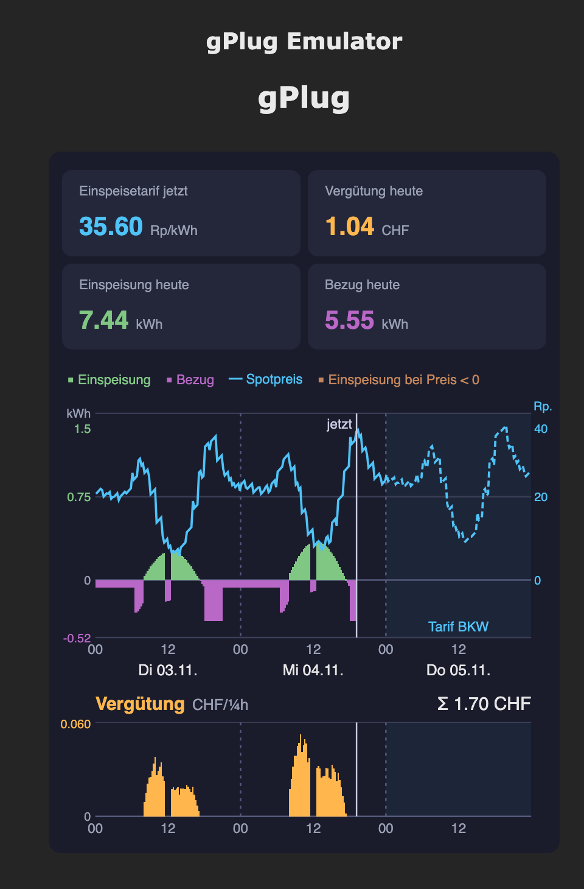
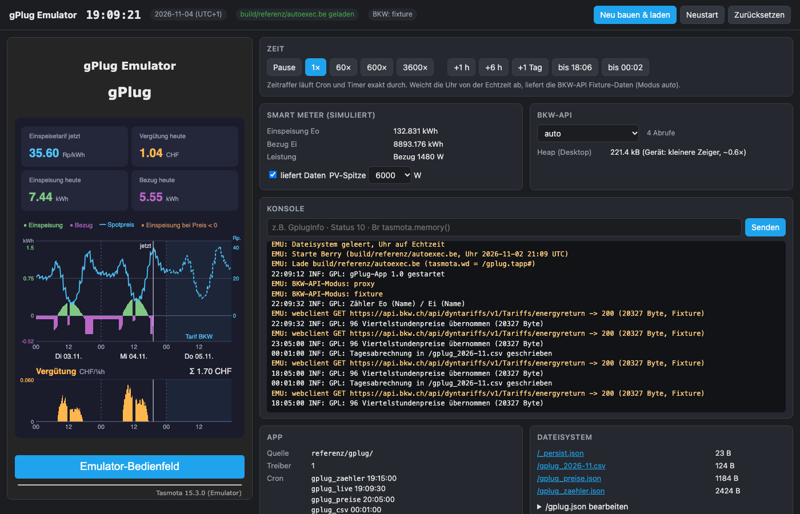

# gPlug-Workshop: Eine eigene gPlug-App für die Vergütung 2027

Material, Werkzeuge und Referenzlösung für den Workshop der Glue AG am
**12.11.2026** in Bern: Mit KI-Unterstützung (opencode oder Claude Code)
eine Tasmota-App für den gPlug bauen, im Emulator testen und auf den eigenen
gPlug laden.

Die App
- holt die dynamischen **Einspeisetarife der BKW** (Viertelstundenpreise),
- erfasst jede Viertelstunde **Einspeisung und Bezug** am Smart Meter,
- zeigt **gestern, heute und morgen** Energie, Tarif und Vergütung als Grafik im
  Tasmota-WebUI — eine SVG-Einheit pro Viertelstunde (3 × 96 = 288, auf die Breite skaliert), morgen nur den Tarif
  (ab ~18 Uhr),
- schreibt jeden Tag eine Zeile in eine **CSV-Datei pro Monat**,
- als Zusatz: erkennt die Zählernamen selbst aus dem SML-Skript und bietet Konsolenbefehle
  (`GplugInfo`, `GplugPreise`, `GplugAbruf`).



Oben die Momentanwerte (alle ~2 s aktuell). In der Grafik Einspeisung nach oben
(grün), Bezug nach unten (violett), der BKW-Einspeisetarif als Linie (morgen
gestrichelt) und darunter die Vergütung pro Viertelstunde mit Summe. Den
Bezugstarif liefert die API nicht — der Bezug erscheint darum nur in kWh.

## Schnellstart

Voraussetzung: **Docker Desktop** (Windows, macOS, Linux) und git. Sonst nichts —
Compiler, Emulator und KI-Agenten laufen in Containern. Die Befehle sind in
PowerShell, Terminal und bash identisch.

```bash
git clone https://github.com/proBieri/glue-workshop-smart-energy.git
cd glue-workshop-smart-energy
docker compose build                       # einmalig, ~3 min

cp .env.example .env                       # Windows: copy .env.example .env
#   → Infomaniak-Token, Produkt-ID eintragen (Modell: Qwen/Qwen3.5-397B-A17B-FP8)

docker compose up -d emulator              # Emulator → http://localhost:8080/emu
docker compose run --rm opencode           # KI-Agent opencode (Qwen über Infomaniak)
docker compose up opencode-web             # … oder im Browser: http://localhost:4096
#   oder
docker compose run --rm claude             # KI-Agent Claude Code
```

Bei `up` immer den Dienst nennen (`emulator`, `referenz`, `opencode-web`): ein nacktes
`docker compose up -d` startet alle Dienste, auch Agenten und Werkzeuge. **Ältere
Docker-Installation** ohne `docker compose` (nur `docker-compose` v1, ab 1.25): überall
`docker-compose` statt `docker compose` schreiben, sonst gleich.

Im Agenten pro Use Case: `/plan uc1`, dann `/build uc1` (neue Sitzung je Use Case). `/build`
baut und testet im Container, erzeugt immer `build/gplug.tapp` und lädt die App in den Emulator.

Ohne Agent:

```bash
docker compose run --rm tools bash build.sh   # gplug/ bauen → build/gplug.tapp
docker compose run --rm tools bash test.sh    # Abnahmetests im Emulator
docker compose up -d referenz                 # Referenzlösung → http://localhost:8090/emu
```

## Emulator

`docker compose up -d emulator` startet den Emulator: eine nachgebaute Tasmota-Hauptseite
(http://localhost:8080/) und das Bedienfeld (http://localhost:8080/emu). Die App
läuft dort im gleichen Berry wie auf dem gPlug (Tasmota 15.3.0), mit simuliertem
Smart Meter und der BKW-API (live oder als Fixture).



- **Zeit**: Zeitraffer bis 3600×, Sprünge (+1 h, +1 Tag, bis 18:06, bis 00:02).
  Cron und Timer laufen dabei exakt durch — so ist ein ganzer Tag in Sekunden
  gefüllt. Weicht die Uhr von der Echtzeit ab, liefert die BKW-API Fixture-Daten.
- **Smart Meter**: Zählerstände `Eo`/`Ei`, Leistung, PV-Spitze; ein-/ausschaltbar.
- **Konsole**: Tasmota-Befehle wie auf dem Gerät (`Status 10`, `Br tasmota.memory()`,
  mit UC6 `GplugInfo`); darunter das Log mit Fehlerstellen als `gplug/datei.be:zeile`.
- **App, Dateisystem**: geladene Quelle, Cron-Zeitpunkte, Dateien zum Ansehen und
  `/gplug.json` zum Bearbeiten.
- **Neu bauen & laden**, **Neustart**, **Zurücksetzen** (leeres Dateisystem, Uhr auf Echtzeit).

`build.sh` lädt jede gebaute App selbst in den laufenden Emulator — wie das
Hochladen auf den gPlug — und meldet `Emulator: App geladen`. Startet die App
dort nicht, bricht der Build mit dem Log ab. `build/` geht an den Emulator
(:8080), `build/referenz/` an die Referenz (:8090).

## Ablauf mit dem KI-Agenten

Zwei Befehle, ein Use Case pro Sitzung (`/new` dazwischen):

| Schritt | Befehl | Ergebnis |
|---|---|---|
| Spezifikation lesen | — (du) | `spec/`: 4 Use Cases (UC1–UC4) plus 2 Zusätze (UC5, UC6), je Vertrag, Regeln, Testtabelle und eingeklappter Testcode |
| Planen | `/plan ucN` | Plan im Chat (nur lesen): Dateien, Puffer, APIs, welcher Test wodurch grün wird |
| Umsetzen, bauen, testen | `/build ucN` | `gplug/*.be`, Tests grün, `build/gplug.tapp`, App im Emulator geladen |
| Erweitern | `/build <Auftrag>` | Code + Zeile in der Spec-Testtabelle + Test |

## Struktur

```
spec/            UC1 Tarife · UC2 Zähler · UC3 WebUI · UC4 CSV · Zusatz: UC5 Zählernamen aus dem Skript, UC6 Befehle
gplug/           deine App (Start: minimales main.be + vorgegebene gplug_ui.html)
referenz/gplug/  Referenzlösung (alle Tests grün)
emulator/        Tasmota-Emulator: Berry-Mock, Test-Runner, Web-Bedienfeld
docker/          Dockerfile (Berry aus Tasmota 15.3.0, opencode)
workshop/        Präsentation, Grundlagen, Anleitungen
build.sh test.sh Bauen und Testen (im Container)
agents-sync.sh   hält .opencode/ und .claude/ (Befehle, Skills) synchron
```

## Auf den gPlug laden

1. `docker compose run --rm tools bash build.sh` → `build/gplug.tapp`
2. gPlug-WebUI → *Werkzeuge → Dateisystem verwalten* → `gplug.tapp` hochladen
3. Konsole `Status 10`: heissen die Zählerstände nicht `Eo`/`Ei` (bzw. `Eo1`, `Eo2` …) in kWh,
   im Dateisystem `gplug.json` anlegen, z.B. `{"key_ein":"Lief_HT+Lief_NT","key_bez":"Bezug_HT+Bezug_NT","einheit":"Wh"}`
4. *Neustart* — die App startet automatisch, Grafik erscheint auf der Hauptseite
5. Prüfen: `http://<ip>/gplug/chart.json` antwortet, Tarif-Kachel gefüllt (mit UC6: Konsole `GplugInfo`)

Ohne Browser (IP anpassen):

```bash
curl http://<ip>/ufsu
curl -F "ufsu=@build/gplug.tapp;filename=gplug.tapp" "http://<ip>/ufsu?fsz=<Byte>"
curl "http://<ip>/cm?cmnd=Restart%201"
```

Nach einem Update mit neuem Speicherformat beginnen die Werte neu; nach 18 Uhr
liefert die BKW nur noch den Folgetag — die Tarife für heute fehlen dann bis
morgen.

Details: [workshop/teilnehmende.md](workshop/teilnehmende.md).

## Referenzlösung

```bash
docker compose run --rm tools bash test.sh referenz          # 13 Testblöcke, 45 Tests grün
docker compose up -d referenz                    # http://localhost:8090/emu
```

| Datenstruktur | Grösse |
|---|---|
| Tarife 3 Tage × 96 Viertelstunden × int16 | 576 B |
| Einspeisung + Bezug 2 × 3 × 96 × int16 | 1152 B |
| BKW-Antwort beim Abruf (flüchtig, einmal pro Tag) | ~22 kB |
| Grafik-HTML beim Seitenaufruf (vorgegebene `gplug_ui.html`, flüchtig, aus der .tapp) | ~8.2 kB |
| `chart.json` (Base64 der Puffer, flüchtig, alle 5 min) | ~1.8 kB |

Auf einem gPlugK gemessen (Tasmota 15.3.0, ESP32-C3, zusammen mit `gplug_ha.tapp`,
02.11.2026): `heap_free` 74 kB, Fragmentierung 42 %, `chart.json` 1844 Byte.

## Für Workshop-Leitende

[workshop/README.md](workshop/README.md) — Ablauf, Vorbereitung, Checkliste, Troubleshooting.

## Lizenz

MIT — siehe [LICENSE](LICENSE).
